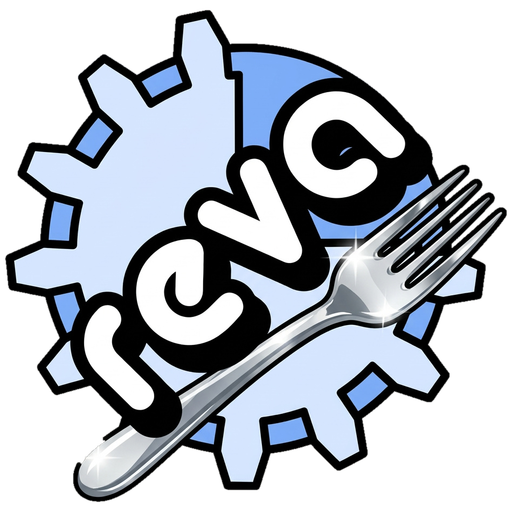

<p align="center"></p>

# reva-fork: Reva Forth on 64-bit hosts and WebAssembly

Copyright (c) 2026 Michael A. Wright

**[Live demo: softwarewrighter.github.io/reva-fork](https://softwarewrighter.github.io/reva-fork/)**,
the Reva REPL in your browser. Try
[a dragon curve](https://softwarewrighter.github.io/reva-fork/?eval=needs%20turtle/fractals&eval=12%20dragon-demo)
or [the tree below](https://softwarewrighter.github.io/reva-fork/?eval=needs%20turtle/fractals&eval=12%20tree-demo),
or [the TUI notebook](https://softwarewrighter.github.io/reva-fork/?eval=needs%20ui/notebook%20notebook)
(type a Forth line such as `6 7 *` in the top pane, then Ctrl-J, Ctrl-X
Ctrl-E, Cmd-Enter or F6; F1 lists the keys).

[](https://softwarewrighter.github.io/reva-fork/?eval=needs%20turtle/fractals&eval=12%20tree-demo)

[](https://softwarewrighter.github.io/reva-fork/?eval=needs%20turtle/fractals&eval=10%20tree-demo&eval=needs%20ui/notebook%20notebook)

[](https://softwarewrighter.github.io/reva-fork/?eval=needs%20ui/cd-demo%20cd-demo)

Reva is a compact, native-code Forth for 32-bit x86 by Ron Aaron and the Reva
development team. Its original README is kept, unchanged, as
[orig-README](orig-README).

This fork carries Reva forward to machines and places 32-bit x86 no longer
reaches: x86-64 and ARM64 on Linux, macOS and Windows, and the web browser
through WebAssembly. It does that with a **portable core** written in Rust
that runs Reva's own Forth system, `src/reva.f` (release 2011.2), unchanged.

## What it can do

- **Three hosts, one core.** The `reva` command, the browser
  ([live demo](https://softwarewrighter.github.io/reva-fork/); offline as
  [reva-serve](docs/serve.md) or a [zip](docs/web.md)), and a
  [desktop app](docs/desktop.md). Files persist in each: on disk, or in
  the browser's IndexedDB, with an Upload button.
- **Reva's libraries.** `needs` loads `lib/` as in Reva:
  [turtle graphics](docs/turtle.md) with fractal demos (SVG or PNG files
  from the CLI), [SQLite](docs/sqlite.md) in all three hosts, iconv,
  [colour listings](docs/highlight.md) (`pp FILE`).
- **IUP programs** run unchanged on a model of IUP
  ([ui-model.md](docs/ui-model.md)): a text UI in the terminal, the browser
  and the desktop app, with CD canvases and timers in the browser and the
  desktop app (`examples/iup/brownian.f`, `binary-clock.f`, `cd-test.f`;
  [try it](https://softwarewrighter.github.io/reva-fork/?eval=needs%20ui/cd-demo%20cd-demo)).
  The [notebook](https://softwarewrighter.github.io/reva-fork/?eval=needs%20ui/notebook%20notebook)
  (`needs ui/notebook notebook`) evaluates Forth lines in place and keeps
  them in a file.
- **Saved images.** `save` and `reva --save-image` write the system's state;
  every host starts from an image, prompt and all.
- **Errors that say where.** `FILE:LINE`, the word, the stack, and the
  words that called the one at fault; opt-in checks find a hidden underflow,
  an `execute` of what is not code, or a word that compiles where it should
  run ([diagnostics.md](docs/diagnostics.md)).
- **Programs that never end** pause in the browser, with a bar to go on or
  stop, and `reva --max-cpu` limits them in the CLI; `ms` waits without
  freezing the page.
- **Older programs.** `needs compat/reva70` gives Reva 7.0's behaviour
  ([compat-reva70.md](docs/compat-reva70.md)) for programs such as
  [CoSy](docs/cosy-in-reva.md); `reva --port-check` finds Windows-only paths
  and commands and writes portable copies
  ([porting-from-windows.md](docs/porting-from-windows.md)).
- **A REPL that edits.** History, Ctrl-R search and Emacs keys in every
  host; pasted lines run one by one ([repl.md](docs/repl.md)).
- **Packages.** A folder with start files and an icon opens as its own app
  in the desktop app and the browser ([desktop.md](docs/desktop.md)).

What runs and what does not, program by program, is in
[docs/parity.md](docs/parity.md); the pitfalls are in
[docs/gotchas.md](docs/gotchas.md).

## How it works

Reva compiles Forth straight to x86 machine code, and about 60 words in
`src/reva.f` (and about 100 in the libraries) are *written* as instruction
bytes. Rewriting all of that for a new target would be a new Forth, not a
port. Instead, the portable core:

- **executes the small IA-32 subset Reva actually uses** ("vx86") in a Rust
  virtual machine, over one flat 32-bit address space, which maps directly
  onto `wasm32` linear memory and onto a single buffer on a 64-bit host;
- **re-implements the assembly core's routines in Rust** as *gateways* at the
  addresses Reva expects, so the Forth side sees the same core it always did;
- **never blocks**: it runs in budgeted slices behind a small `Host` trait,
  so the same engine serves a terminal and a browser tab without freezing it.

The result: `src/reva.f` boots in full, byte-for-byte, including its embedded
assembler, contexts, `needs` and libraries, `does>`, `catch`/`throw`, the FFI
layer (over a virtual libc and a portable `syscall` subset) and the REPL with
its banner, `ok>` prompt and error handling.

The options that were weighed (a token-threaded VM, hand-written 64-bit
assembly cores, and this one), the architecture, the non-functional
requirements and the deliberate deviations from the original core are in
[docs/design.md](docs/design.md).

## Quick start

Requires a Rust toolchain (stable, 1.89 or newer). For the browser build, also the
`wasm32-unknown-unknown` target and `wasm-bindgen` (the version
`components/ui-web` pins).

```bash
cargo build --release --manifest-path components/cli/Cargo.toml   # or: just cli
echo ': sq dup * ; 7 sq .' | target/release/reva    # prints 49
target/release/reva                                # interactive REPL
target/release/reva --help

just serve                                         # the browser REPL as one binary: http://127.0.0.1:8421/
```

`just serve` builds the web site and [reva-serve](docs/serve.md), a small
server with the site inside, and opens it in your browser.

Desktop app (Linux, macOS; see [docs/desktop.md](docs/desktop.md)):

```bash
components/desktop/build.sh --install                         # once; needs WebKitGTK 4.1 headers on Linux
reva-desktop                                       # the REPL in a window, files in ~/Reva
reva-desktop --package DIR                         # open a package (start files in reva-package.json)
```

`needs` finds libraries in `lib/` of this checkout (or under `$REVA_HOME`)
through the virtual install prefix `/reva/`.

## Repository layout

| Path | What it is |
|---|---|
| [`components/`](components/README.md) | the portable core, one Cargo workspace per component (about 35): the x86 subset (`x86-*`), the machine and its words (`core*`, `words*`, `vlib`, `vm`), the UI model and its renderers (`ui*`, `iup`, `cd`, `canvas`), and the hosts: `cli` (the `reva` command), `web` (WebAssembly module and web console), `serve`, `desktop` (the Tauri app); [docs/design.md](docs/design.md) lists them all |
| `scripts/`, `tests/forth/`, `work/reg-rs/` | build and gate scripts, the regression suite's Forth scripts and goldens |
| `src/reva.f`, `src/help.txt`, `lib/`, `examples/`, `tests/`, `bench/` | the Reva Forth system itself, as imported; the portable core runs it |
| [`docs/`](docs/README.md) | new documentation, written from the portable core; every Forth sample in it is executed by the test suite |
| [`legacy/`](legacy/README.md) | the deprecated 32-bit x86 implementation: assembly core, build machinery, prebuilt binaries |
| `www/` | the old wiki, deprecated (see below) |
| [`orig-README`](orig-README), `CREDITS`, `THANKS!` | the original Reva distribution's notes |
| [`original-README.md`](original-README.md) | this README's earlier sections (status, roadmap, quality, branches), kept unmaintained |

## Documentation

New documentation lives in [docs/](docs/README.md):
[getting started](docs/getting-started.md), [gotchas](docs/gotchas.md),
and the [parity tracker](docs/parity.md), which records, topic by topic and
program by program, how much of the old wiki and of `examples/` the portable
core covers.

The old wiki in `www/` describes the x86 distribution and is deprecated. It
is retired in the three steps set out in [DEPRECATED.md](DEPRECATED.md):
deprecate (done), move to `legacy/www/` once `docs/parity.md` shows every
still-supported topic rebuilt, then delete with the rest of `legacy/`.

## Status, roadmap and history

What runs today, topic by topic and program by program, is tracked in
[docs/parity.md](docs/parity.md) (with the [generated report](docs/parity-examples.md)
for `examples/`), and every change is listed in [CHANGES.md](CHANGES.md).
The README's earlier Status, Roadmap, Quality and Branches sections are
kept, unmaintained, in [original-README.md](original-README.md).

## Third-party software

- **SQLite** ([public domain](https://sqlite.org/copyright.html)), for
  `needs db/sqlite`. The CLI and the desktop app build it in through the
  [rusqlite](https://github.com/rusqlite/rusqlite) crate (MIT). The browser
  build does not include it: the page loads SQLite's official WebAssembly
  build, the [@sqlite.org/sqlite-wasm](https://github.com/sqlite/sqlite-wasm)
  package (Apache-2.0), from jsDelivr at run time, the first time a program
  uses SQLite.
- The desktop app is built on [Tauri](https://tauri.app) (MIT/Apache-2.0).

Every crate and its license, and what is loaded at run time, are listed in
[docs/licenses.md](docs/licenses.md); the About dialog in the web REPL and
the desktop app credits them too.

## License

Copyright (c) 2026 Michael A. Wright

The new work in this repository (the portable core under `components/`, this
README, `docs/` and the other files listed in [LICENSING.md](LICENSING.md))
is released under the **MIT License**; see [LICENSE-MIT](LICENSE-MIT):

> Permission is hereby granted, free of charge, to any person obtaining a
> copy of this software and associated documentation files (the
> "Software"), to deal in the Software without restriction, including
> without limitation the rights to use, copy, modify, merge, publish,
> distribute, sublicense, and/or sell copies of the Software, and to permit
> persons to whom the Software is furnished to do so, subject to the
> following conditions:
>
> The above copyright notice and this permission notice shall be included
> in all copies or substantial portions of the Software.
>
> THE SOFTWARE IS PROVIDED "AS IS", WITHOUT WARRANTY OF ANY KIND, EXPRESS OR
> IMPLIED, INCLUDING BUT NOT LIMITED TO THE WARRANTIES OF MERCHANTABILITY,
> FITNESS FOR A PARTICULAR PURPOSE AND NONINFRINGEMENT. IN NO EVENT SHALL
> THE AUTHORS OR COPYRIGHT HOLDERS BE LIABLE FOR ANY CLAIM, DAMAGES OR OTHER
> LIABILITY, WHETHER IN AN ACTION OF CONTRACT, TORT OR OTHERWISE, ARISING
> FROM, OUT OF OR IN CONNECTION WITH THE SOFTWARE OR THE USE OR OTHER
> DEALINGS IN THE SOFTWARE.

The original Reva Forth keeps its own terms, which this fork does not
change:

- Reva Forth by Ron Aaron (ron@ronware.org) and the Reva development team
  is dedicated to the public domain, with an unconditional fall-back
  permission grant: [LICENSE](LICENSE). Ron Aaron asks for credit as the
  original author where Reva is useful; this project gives it.
- The x86 assembler embedded in `src/reva.f` is adapted from the FirmWorks
  assembler, Copyright (c) 2006 FirmWorks, under the MIT-style notice in
  [LICENSE](LICENSE).
- The IUP libraries under `legacy/bin/` are under [LICENSE.IUP](LICENSE.IUP).

[LICENSING.md](LICENSING.md) maps every part of the repository to its terms.
