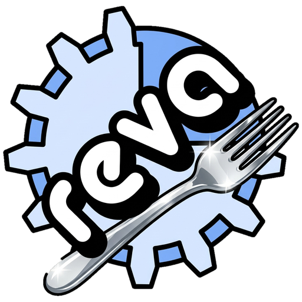

<p align="center"></p>

# reva-fork: Reva Forth on 64-bit hosts and WebAssembly

Copyright (c) 2026 Michael A. Wright

Reva is a compact, native-code Forth for 32-bit x86 by Ron Aaron and the Reva
development team. Its original README is kept, unchanged, as
[orig-README](orig-README).

This fork carries Reva forward to machines and places 32-bit x86 no longer
reaches: x86-64 and ARM64 on Linux, macOS and Windows, and the web browser
through WebAssembly. It does that with a **portable core** written in Rust
that runs Reva's own Forth system, `src/reva.f` (release 2011.2), unchanged.

## How it works

Reva compiles Forth straight to x86 machine code, and about 60 words in
`src/reva.f` (and about 100 in the libraries) are *written* as instruction
bytes. Rewriting all of that for a new target would be a new Forth, not a
port. Instead, the portable core:

- **executes the small IA-32 subset Reva actually uses** ("vx86") in a Rust
  virtual machine, over one flat 32-bit address space, which maps directly
  onto `wasm32` linear memory and onto a single buffer on a 64-bit host;
- **re-implements the assembly core's routines in Rust** as *gateways* at the
  addresses Reva expects, so the Forth side sees the same core it always did;
- **never blocks**: it runs in budgeted slices behind a small `Host` trait,
  so the same engine serves a terminal and a browser tab without freezing it.

The result: `src/reva.f` boots in full, byte-for-byte, including its embedded
assembler, contexts, `needs` and libraries, `does>`, `catch`/`throw`, the FFI
layer (over a virtual libc and a portable `syscall` subset) and the REPL with
its banner, `ok>` prompt and error handling.

The options that were weighed (a token-threaded VM, hand-written 64-bit
assembly cores, and this one), the architecture, the non-functional
requirements and the deliberate deviations from the original core are in
[rust/DESIGN.md](rust/DESIGN.md).

## Quick start

Requires a Rust toolchain (stable). For the browser build, also the
`wasm32-unknown-unknown` target.

```bash
cd rust
cargo build --release
echo ': sq dup * ; 7 sq .' | target/release/reva    # prints 49
target/release/reva                                # interactive REPL
target/release/reva --help

scripts/build-web.sh                               # reva-web/www/reva.wasm
python3 -m http.server -d reva-web/www             # open http://localhost:8000
```

Desktop app (Linux, macOS; see [docs/desktop.md](docs/desktop.md)):

```bash
desktop/build.sh --install                         # once; needs WebKitGTK 4.1 headers on Linux
reva-desktop                                       # the REPL in a window, files in ~/Reva
reva-desktop --package DIR                         # open a package (start files in reva-package.json)
```

`needs` finds libraries in `lib/` of this checkout (or under `$REVA_HOME`)
through the virtual install prefix `/reva/`.

## Repository layout

| Path | What it is |
|---|---|
| [`rust/`](rust/README.md) | the portable core: `reva-vm` (VM library), `reva-cli` (the `reva` command), `reva-web` (WebAssembly module and web console), tests and scripts |
| `src/reva.f`, `src/help.txt`, `lib/`, `examples/`, `tests/`, `bench/` | the Reva Forth system itself, as imported; the portable core runs it |
| [`desktop/`](docs/desktop.md) | the desktop app (Tauri), in its own Cargo workspace so the core stays dependency-free |
| [`docs/`](docs/README.md) | new documentation, written from the portable core; every Forth sample in it is executed by the test suite |
| [`legacy/`](legacy/README.md) | the deprecated 32-bit x86 implementation: assembly core, build machinery, prebuilt binaries |
| `www/` | the old wiki, deprecated (see below) |
| [`orig-README`](orig-README), `CREDITS`, `THANKS!` | the original distribution's notes |

## Documentation

New documentation lives in [docs/](docs/README.md):
[getting started](docs/getting-started.md), [gotchas](docs/gotchas.md),
and the [parity tracker](docs/parity.md), which records, topic by topic and
program by program, how much of the old wiki and of `examples/` the portable
core covers.

The old wiki in `www/` describes the x86 distribution and is deprecated. It
is retired in the three steps set out in [DEPRECATED.md](DEPRECATED.md):
deprecate (done), move to `legacy/www/` once `docs/parity.md` shows every
still-supported topic rebuilt, then delete with the rest of `legacy/`.

## Status

- **Works:** all of `reva.f`; the REPL; `include` and `needs`; contexts;
  the embedded assembler; the file words (real files on the CLI; in the
  browser, in memory and kept in `localStorage`); `time&date`, `ms@`,
  `getenv`; saved images (`save`, `--image`, also in the browser) and
  `restart`. 69 of the 132
  programs in `examples/` run unchanged
  ([generated report](docs/parity-examples.md)).
- **Hosts:** the `reva` command on any 64-bit platform Rust supports, and a
  zero-import WebAssembly module with a minimal web console that runs it in
  a Web Worker (the page never freezes; Stop interrupts a running word).
- **x87 floating point** with double-precision registers:
  `lib/math/floats` passes its own tests.
- **Not yet:** native C libraries, and translation to native code.

## Roadmap

1. Virtual libraries (Rust bindings inside the VM; no generic native FFI,
   see [docs/portability.md](docs/portability.md)): SQLite, then a UI
   service (panes, keys, SVG, later WebGL 3D) for the browser and the
   desktop app.
2. Translators that turn hot vx86 code into x86-64, ARM64 and WebAssembly,
   to recover native speed (the interpreter is the reference semantics; the
   translations are caches over it).

The first practical goal on this road is a **static WebAssembly demo of
[CoSy](http://cosy.com/)**, Bob Armstrong's APL/K-like vocabulary built on
Reva: a directory of HTML, JavaScript, CSS and a `.wasm` file that can be
served from any static web server, with no installation. The steps above
that it needs (files, then floats) come first; CoSy-specific code is kept
out of this repository, which receives only general-purpose Reva changes.

## Quality

The port is developed with these qualities in mind, each with a concrete
mechanism described in [rust/DESIGN.md §4](rust/DESIGN.md#4-non-functional-requirements):

- **Portability and availability:** pure Rust, no `unsafe` in the VM, no
  runtime dependencies; one core for the CLI and the browser.
- **Reliability:** bounds-checked memory, stack checks between words, and
  faults that recover to the REPL and roll back a half-made definition.
- **Traceability and serviceability:** faults name the Forth word and
  offset; `reva --trace` logs every step; a probe tool disassembles words.
- **Maintainability and understandability:** `reva.f` is run verbatim, not
  forked; small modules with literate headers; documented deviations.
- **Testability:** unit and API tests (`cargo test`), a golden-output
  regression suite (`rust/scripts/regress.sh`, using
  [reg-rs](https://github.com/sw-cli-tools/reg-rs)), and executed
  documentation samples.
- **Upgradability:** images hold only vx86 bytes and are versioned; native
  translations are never persisted.

## Branches

- `dev`: the default branch. Every change merges here first.
- feature branches: one per change, branched from `dev` and merged back.
- `main`: the tested release line. `dev` merges into `main` (with a merge
  commit, never a squash, so the two histories stay aligned) once the gates
  pass: `cargo test --release --workspace`, `scripts/doc-check.sh` and the
  reg-rs suite. The original x86 import is the first commit, `edc8cbe`.

## License

Copyright (c) 2026 Michael A. Wright

The new work in this repository (the portable core under `rust/`, this
README, `docs/` and the other files listed in [LICENSING.md](LICENSING.md))
is released under the **MIT License**; see [LICENSE-MIT](LICENSE-MIT):

> Permission is hereby granted, free of charge, to any person obtaining a
> copy of this software and associated documentation files (the
> "Software"), to deal in the Software without restriction, including
> without limitation the rights to use, copy, modify, merge, publish,
> distribute, sublicense, and/or sell copies of the Software, and to permit
> persons to whom the Software is furnished to do so, subject to the
> following conditions:
>
> The above copyright notice and this permission notice shall be included
> in all copies or substantial portions of the Software.
>
> THE SOFTWARE IS PROVIDED "AS IS", WITHOUT WARRANTY OF ANY KIND, EXPRESS OR
> IMPLIED, INCLUDING BUT NOT LIMITED TO THE WARRANTIES OF MERCHANTABILITY,
> FITNESS FOR A PARTICULAR PURPOSE AND NONINFRINGEMENT. IN NO EVENT SHALL
> THE AUTHORS OR COPYRIGHT HOLDERS BE LIABLE FOR ANY CLAIM, DAMAGES OR OTHER
> LIABILITY, WHETHER IN AN ACTION OF CONTRACT, TORT OR OTHERWISE, ARISING
> FROM, OUT OF OR IN CONNECTION WITH THE SOFTWARE OR THE USE OR OTHER
> DEALINGS IN THE SOFTWARE.

The original Reva Forth keeps its own terms, which this fork does not
change:

- Reva Forth by Ron Aaron (ron@ronware.org) and the Reva development team
  is dedicated to the public domain, with an unconditional fall-back
  permission grant: [LICENSE](LICENSE). Ron Aaron asks for credit as the
  original author where Reva is useful; this project gives it.
- The x86 assembler embedded in `src/reva.f` is adapted from the FirmWorks
  assembler, Copyright (c) 2006 FirmWorks, under the MIT-style notice in
  [LICENSE](LICENSE).
- The IUP libraries under `legacy/bin/` are under [LICENSE.IUP](LICENSE.IUP).

[LICENSING.md](LICENSING.md) maps every part of the repository to its terms.
