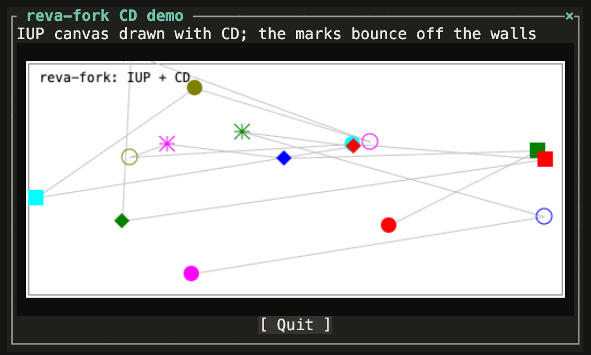

# IUP dialogs and CD graphics

Reva's GUI library runs on reva-fork unchanged: dialogs, boxes, buttons,
labels, text, menus and timers through IUP (`needs ui/gui`), and drawing
on canvases through CD (`needs ui/cd`). There is no native IUP or CD
underneath. reva-fork answers their C functions itself and draws the
dialogs as a text user interface (TUI) of character cells, the same in
every front end. CD canvases are painted in the browser and the desktop
app.

Try it: `needs ui/cd-demo cd-demo`
([live demo](https://softwarewrighter.github.io/reva-fork/?eval=needs%20ui/cd-demo%20cd-demo)).



## Where it runs

| Front end | Dialogs | CD canvases | Timers |
|---|---|---|---|
| browser, live demo, `reva-serve` | yes, in place of the REPL while shown (Ctrl-C or `[×]` closes the top dialog) | yes | yes |
| desktop app | yes (the same page) | yes | yes |
| CLI at a terminal | yes, full screen (Ctrl-C closes the top dialog) | the frame only | no |
| CLI with `--ui-script FILE` | printed, events from FILE (tests) | the drawing as a list | scripted (`timer H`) |
| CLI with piped input | no: it stops with a note | | |

A dialog takes over the REPL until it closes; then the `ok>` prompt
comes back, with everything the program defined.

## The libraries

| `needs` | Context | What |
|---|---|---|
| `ui/gui` | `~ui` | the vocabulary programs use: `dialog[ ... ]d`, `vbox[`, `hbox[`, `button[`, `label[`, `editbox[`, `canvas[`, `attr:`, `action:`, `show`, `gui-main-loop`, timers. It loads `ui/iup` |
| `ui/iup` | `~iup` | IUP's C functions (`IupDialog`, `IupSetAttribute`, ...) and constants |
| `ui/cd` | `~cd` | CD's functions as `cd-` words (`cd-line`, `cd-box`, `cd-text`, `cd-foreground`, ...) and colours (`CD_RED`, ...) |
| `ui/notebook` | `~` | the notebook ([tour.md](tour.md#the-notebook)) |
| `ui/cd-demo` | `~` | the demo above; `pp ui/cd-demo` shows its source |
| `compat/reva70` | | Reva 7.0's `ui/gui`, for programs written for 7.0 ([compat-reva70.md](compat-reva70.md)) |

Read a library with `pp` (built in), e.g.
`pp ui/gui`; [lib/ui/](../lib/ui/) on GitHub has them all.

## A dialog

```text
needs ui/gui
with~ ~ui

variable clicks   variable shown
: count-it callback
    1 clicks +!  shown @ clicks @ (.) attr: TITLE drop  gui-default ;
: quit callback  gui-close ;

: counter ( -- )
    0 clicks !
    dialog[
      vboxs[
        " 0" label[ dup shown ! ]w
        hboxs[
          " Count" button[ action: count-it ]w
          " Quit" button[ action: quit ]w
        ]c
      ]c
    ]d " Counter" title
    show gui-main-loop ;
counter
```

```text
          ┌ Counter ─────[×]┐
          │3                │
          │[ Count ][ Quit ]│
          └─────────────────┘
```

A callback is a word marked `callback`, returning `gui-default` to go
on, or `gui-close` to end `gui-main-loop`. `attr:` sets an IUP
attribute on the element on the stack. Tab moves between the buttons,
Enter or a click presses one, and the `[×]` closes the dialog.

**Ways out.** The close box `[×]` (its corner counts too), or Ctrl-C
with no text selected, closes the dialog on top, as IUP's close box
does: a `CLOSE_CB` callback, if the dialog has one, may keep it open;
otherwise the dialog hides and its loop ends. In the page, a second
Ctrl-C while the same dialog is still there stops the run (`*** stopped
(Ctrl-C)`). A dialog larger than the pane scrolls; in the split view, the
graphics pane steps aside while a dialog is shown and nothing has been
drawn.

**A fault in a callback** is reported as usual but does not end the
dialog: the callback is taken as returning `gui-default` and the loop
goes on, as in IUP, where a callback cannot take the main loop down.

## A drawing

A canvas is an IUP element. CD draws on it from the canvas's ACTION
callback, which runs whenever it needs painting (when it is shown or
resized). Coordinates are pixels, with y going up from the bottom.

```text
needs ui/gui
needs ui/cd
with~ ~ui  with~ ~iup  with~ ~cd

variable canvas  variable cdc
: paint callback
    cdc @ cd-activate drop
    CD_WHITE cd-background drop  cd-clear drop
    CD_BLUE cd-foreground drop  20 20 280 130 cd-line drop
    CD_RED cd-foreground drop  40 120 30 90 cd-box drop
    CD_BLACK cd-foreground drop  150 20 z" hello, CD" cd-text drop
    gui-default ;
: quit callback  gui-close ;

: picture ( -- )
    dialog[
      canvas[ " 300x150" attr: RASTERSIZE  dup canvas ! ]w
      " Quit" button[ action: quit ]w
    ]d " A picture" title
    gui-map
    cd-context-iup  canvas @ action: paint  cd-create-canvas cdc !
    show gui-main-loop
    cdc @ cd-kill-canvas ;
picture
```

`cd-box` takes `xmin xmax ymin ymax`. Each `cd-` word is a C function
bound with `func:`, which leaves the function's result, so most calls
end with `drop`. For animation, give a timer
an ACTION callback that changes the state and draws again; that is how
`cd-demo` and `examples/iup/brownian.f` do it (`timer action-cb: tick
50 set-time start-timer`).

## Reva's examples

`examples/iup/` holds the original Reva's IUP programs, unchanged. 15 of
the 20 run: `binary-clock`, `brownian`, `callback-test`, `cd-test`,
`console`, `db-test`, `file-dlg`, `frame-test`, `hello-world` (1 to 3),
`iup`, `menu-test`, `new-test` and `simple-button`; `examples/tui/notebook.f`
too. The other five need what is not served: IUP's image library
(`gui-test`, `gui-test2`, `image-convert`), OpenGL (`gl-test`) and CD's
PDF context (`pdf-test`).

- **CLI**, at a terminal: `just cli examples/iup/simple-button.f`.
- **Browser or desktop app**: the examples are not built in (only `lib/`
  is). Upload the file (and anything it includes), then
  `include simple-button.f`. In the desktop app, copy it to `~/Reva`.

The [parity report](parity-examples.md) runs them without a terminal or
a script, so it lists them as stopping; the goldens `iup-hello-world`,
`iup-simple-button`, `iup-cd-test` and `iup-brownian` run them with a
script.

## Testing a dialog: `--ui-script`

`reva --ui-script FILE prog.f` runs a program without a screen: the
script answers its events (`click 7`, `key K_F6`, `type 2 3 +`,
`size 2 300 150`, `timer 9`, `screen 80x24`, ...) and `reva` prints what
the dialog shows. That is how the samples on this page were checked, and
how the goldens test IUP programs. The script's format is in
[ui-model.md](ui-model.md#the-virtual-library-iup).

## What is not there

- In a terminal: no canvases (their frame only) and no timers.
- Everywhere: menu bars are not drawn (the dialog keeps their row),
  tabs do not switch, lists cannot be selected, there is no matrix, and
  file dialogs answer "cancelled". The page's dialogs are not separate
  windows.
- CD: no PDF, printer or image-file contexts, no clipping, arcs or fonts
  beyond a size; `cd-vector-text` draws nothing.
- No OpenGL, and no IUP image library.

How it works (the model, the virtual library, the TUI, the canvases):
[ui-model.md](ui-model.md). The plan it came from: [iup-plan.md](iup-plan.md).
